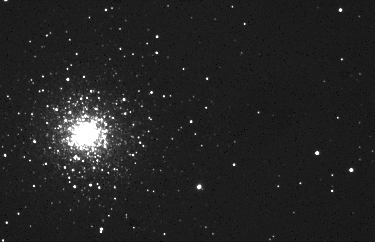

[Click here for more info (translated into English by Google) on MGC 6341.](http://translate.google.com/translate?hl=en&sl=es&u=http://es.wikipedia.org/wiki/C%25C3%25BAmulo_globular_M92&sa=X&oi=translate&resnum=5&ct=result&prev=/search%3Fq%3Dm92%2Bwiki%26hl%3Den%26client%3Dfirefox-a%26rls%3Dorg.mozilla:en-US:official%26hs%3DPyO%26sa%3DG)
