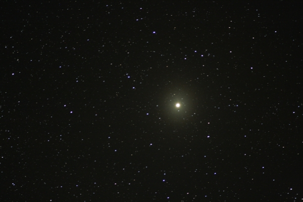

The left upper star in Orion that is ready to explode. It’s in the process of doing just that and is a giant red star. It has a shell of gas and debris going out from it and will do it again and again till it does the final blowup. 
