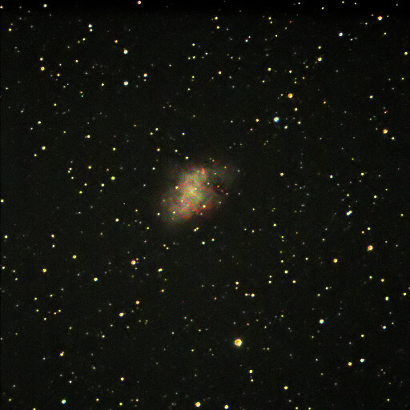

Instrument: Celestron 9.25 Schmidt Cassegrain Telescope  
Camera: SBIG ST-9e  
Mount: Losmandy G11

M1 the Crab Nebula in living color… taken here last night of the 12th, 2010. They are taken, aligned, stacked about 10 and 10 seconds each LRGB.  

