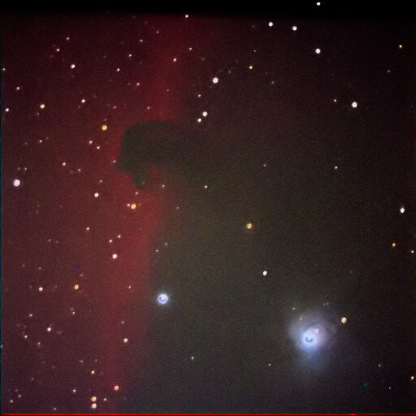

Instrument: Celestron 9.25 Schmidt Cassegrain Telescope  
Camera: SBIG ST-9e  
Mount: Losmandy G11

This is the Horsehead Nebula above the orion nebula in Orion. Very near the belt of stars and used 30 seconds each and 1.6 times or I think I used 48 seconds for the Blue. It’s magnitude is very weak or around 30. I was lucky to get it but the C9.25 telescope and ST9XE came through it. Very hard conditions with reflected light from the snow pack.  

