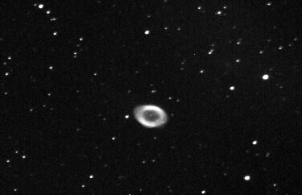

Instrument: Celestron 9.25 Schmidt Cassegrain Telescope  
Camera: SBIG ST-6b (broken?)  
Mount: Losmandy G11  
Exposure: 30 seconds  
Notes: This is an exploding star called M57 and near the star Vega that is overhead at about 10pm now. Vega is part of the summer triangle of stars. Vega is viewed end on and is fat in the middle because it’s spin rate is fast.  

