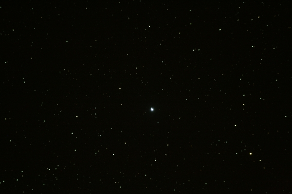

Instrument: 80mm Homebuilt Achromatic Telescope  
Camera: Canon EOS 400D with T-adapter  
Filter: Orion V-Block  
Mount: Losmandy G11  
Date/Time: January 29, 2009 at 2043  
Exposure: Single 52sec, ISO 800, JPEG  

