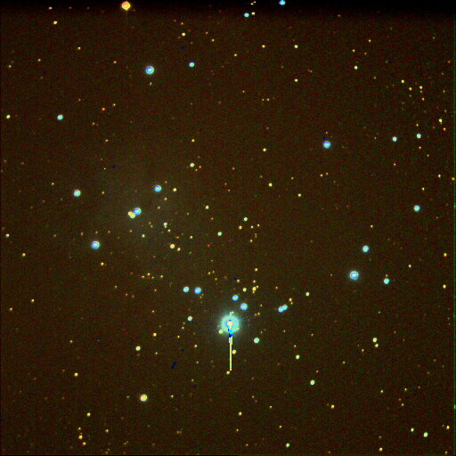

Instrument: Celestron 9.25 Schmidt Cassegrain Telescope  
Camera: SBIG ST-9e  
Mount: Losmandy G11

This is an open star cluster of young stars and thats why the blue color. One doen’t get the color and things like that in black and white. These are two sets of LRGB filters in the wheel ahead of the new imager. Very adverse conditions last night 1-11-10. Ten seconds each image and blue is 1.6 times 10 so 16 seconds…I actually used 17 seconds with the B.  

