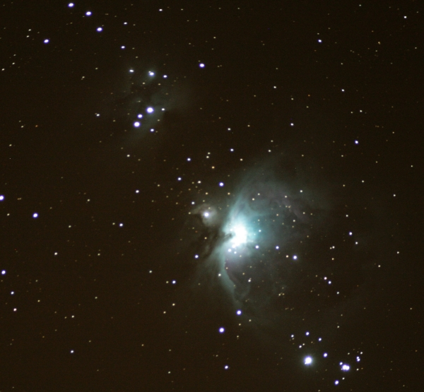

Instrument: 80mm Homebuilt Achromatic Telescope  
Camera: Canon EOS 400D with T-adapter  
Filter: Orion V-Block  
Mount: Losmandy G11  
Date/Time: January 20, 2009  
Location: Pine River, MN  
Weather: Clear, 10degF  
Exposure: Single 4min bulb, ISO 800, JPEG  
Image Processing: Irfanview (cropping and minor contrast)
