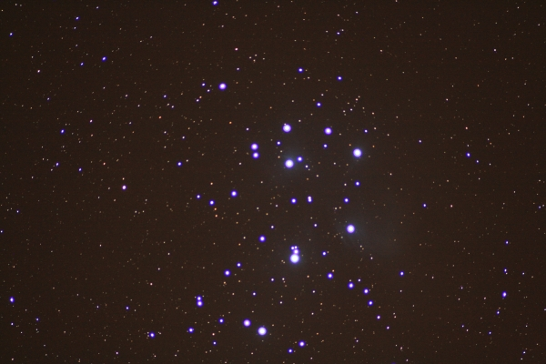

Instrument: 80mm Homebuilt Achromatic Telescope  
Camera: Canon EOS 400D with T-adapter  
Filter: Orion V-Block  
Mount: Losmandy G11  
Exposure: Single 4min, ISO 800, JPEG  
Image Processing: Irfanview (cropping)
