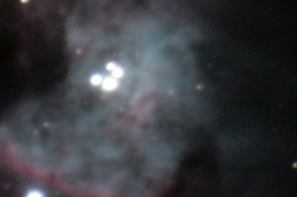

It’s in the heart of the orion nebula and are stars that are considered born there from the nebula …looks to me maybe the nebula is at least lit up by them I guess.  
Instrument: 80mm Homebuilt Achromatic Telescope  
Camera: Canon EOS 400D with T-adapter  
Filter: Orion V-Block  
Mount: Losmandy G11  
Exposure: Single 27sec, ISO 800, JPEG  
Processing: Irfanview (cropping)  

