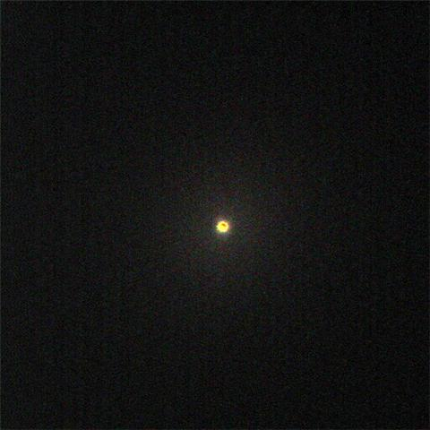

This is my color picture with the new ST9XE and Color filter wheel from SBIG of Betelgeuse the upper star in Orion.  The star is directly south of me at 10pm local time.  The star is in the process of exploding and is a giant star and I mean giant.

Here’s a video that illustrates the relative size of Betelgeuse:

<iframe allowfullscreen="true" class="youtube-player" height="360" sandbox="allow-scripts allow-same-origin allow-popups allow-presentation allow-popups-to-escape-sandbox" src="https://www.youtube.com/embed/k7hsQA3wo3Q?version=3&amp;rel=0&amp;showsearch=0&amp;showinfo=1&amp;iv_load_policy=1&amp;fs=1&amp;hl=en&amp;autohide=2&amp;wmode=transparent" style="border:0;" title="YouTube video player" width="640"></iframe>
