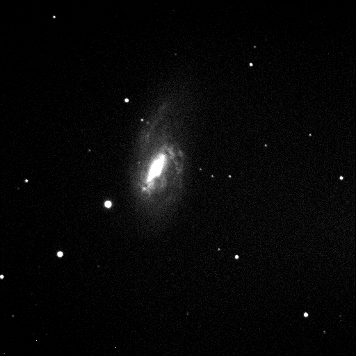
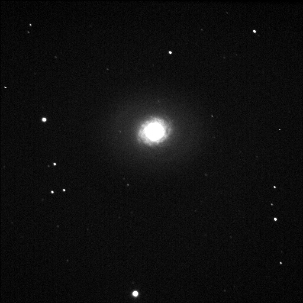
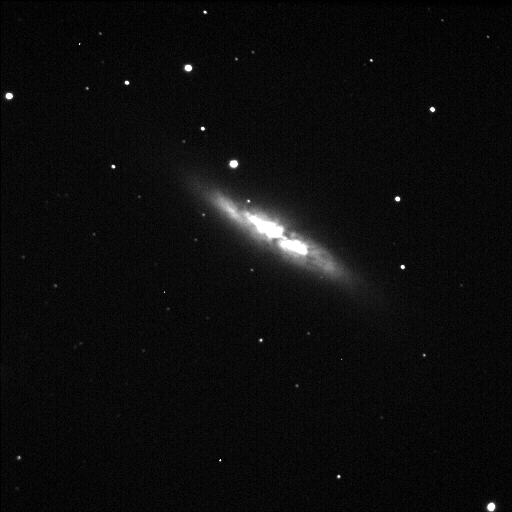
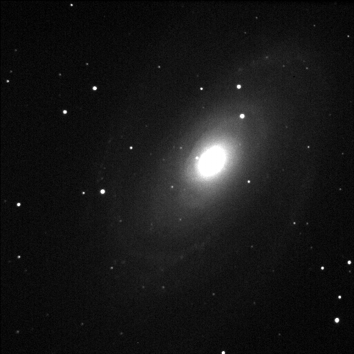
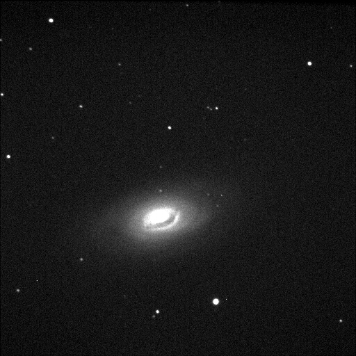
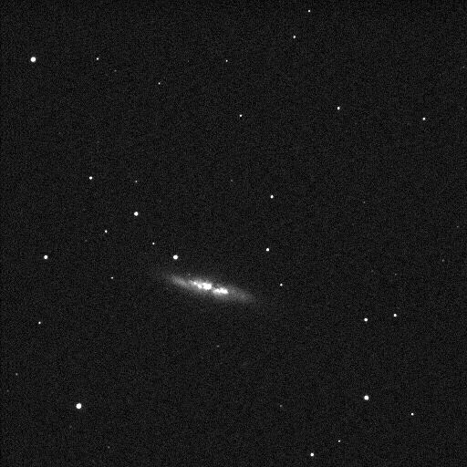

I got some but had a lot of light from moon being half lit up.

M66 is an Intermediate spiral galaxy 36 million light years away in the constellation Leo. Telescope is C9.25 @ F10 on Losmandy G11 with Gemini and Tpoint. Time is 30 seconds exposure. Temperature is - 20 degrees.

M94 contains both an inner ring with a diameter of 70" and an outer ring with a diameter of 600". These rings appear to form at locations within the disk of the galaxy. The inner ring is the site of strong star formation activity and is sometimes referred to as a starburst ring. This star formation is fueled by gas that is dynamically driven into the ring by the inner oval-shaped bar-like structure.

Messier 82 is the prototype of a nearby galaxy and is about 12 million lightyears away in the Ursa Major or the Big Dipper. This starburst galaxy is five times as bright as the whole Milky Way galaxy and one hundred times as bright as our galaxy's core.

Messier 81 is the largest galaxy in the M81 group, a group of 34 galaxies located in the constellation Ursa Major. The distance from the Earth to the group is approximately 11.7 Mlight years (3.6 million parsecs), making this one of the closest groups to the Local Group which contains the Milky way galaxy.

This spiral galaxy is M64, sometimes known as the Black Eye Galaxy. M64 lies about 17 million light-years distant in the otherwise well-groomed northern constellation Coma Berenices. The dark clouds along the near-side of M64s central regeion that give the galaxy its black-eye appearance are enormous obscuring dust clouds associated with star formation, but they are not the galaxy's only peculiar feature. Observations that M64 is actually made of two concentric, counter-rotating systems of stars, one in the inner 3,000 light-years and another extending to about 40,000 light-years and rotating in the opposite direction. The dusty black eye and bizarre rotation is likely the result of a coming together of two different galaxies.

Messier 82 is the prototype of a nearby galaxy and is about 12 million lightyears away in the Ursa Major or the Big Dipper. This starburst galaxy is five times as bright as the whole Milky Way galaxy and one hundred times as bright as our galaxy's core.
