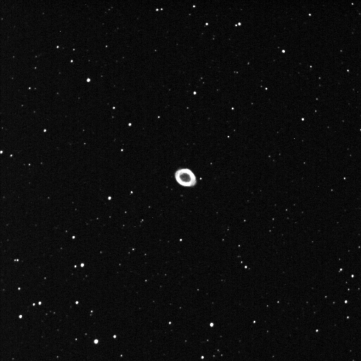
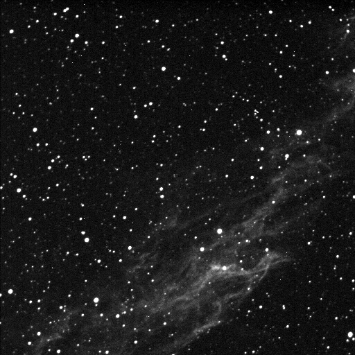
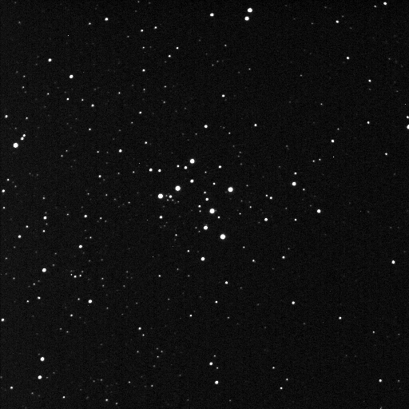
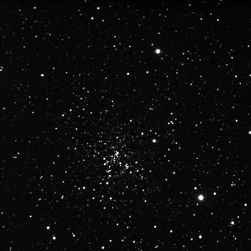
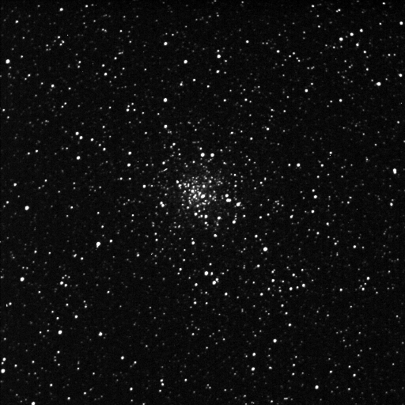
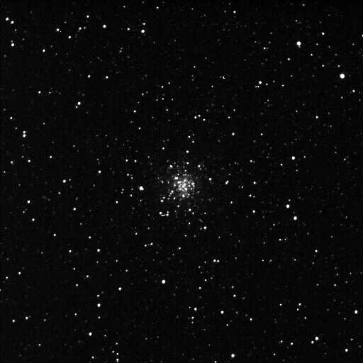

The Telescope is C9.25 on a Losmandy G11 with Gemini, a focal reducer to F6.3 with color wheel CFW9 and Imager is SBIG 9XE. 20degrees below ambient at 94% eff. is all it can muster in this heat. Most are 20 second to 30 second exposure except the gas cloud is at 2 minutes. Having problems with synchronizing and mapping and have to look into that. Computer goes back to the shop for a look see. The system he put on isn’t working like it should. Only half the sound system is there for one and wont map for the other and it should if it’s normal and it is. I focused up on the clear opening to the filter wheel and not the clear filter so its straight to the imager.

M57

NGC6992

NGC6913

NGC6819

M71

NGC6779
