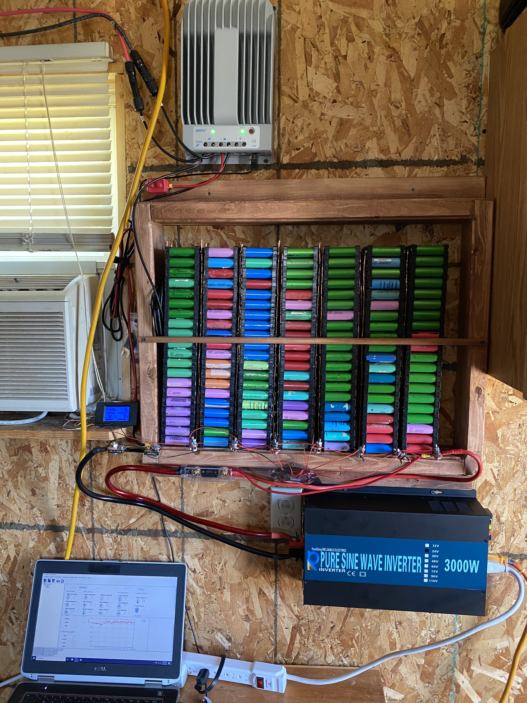
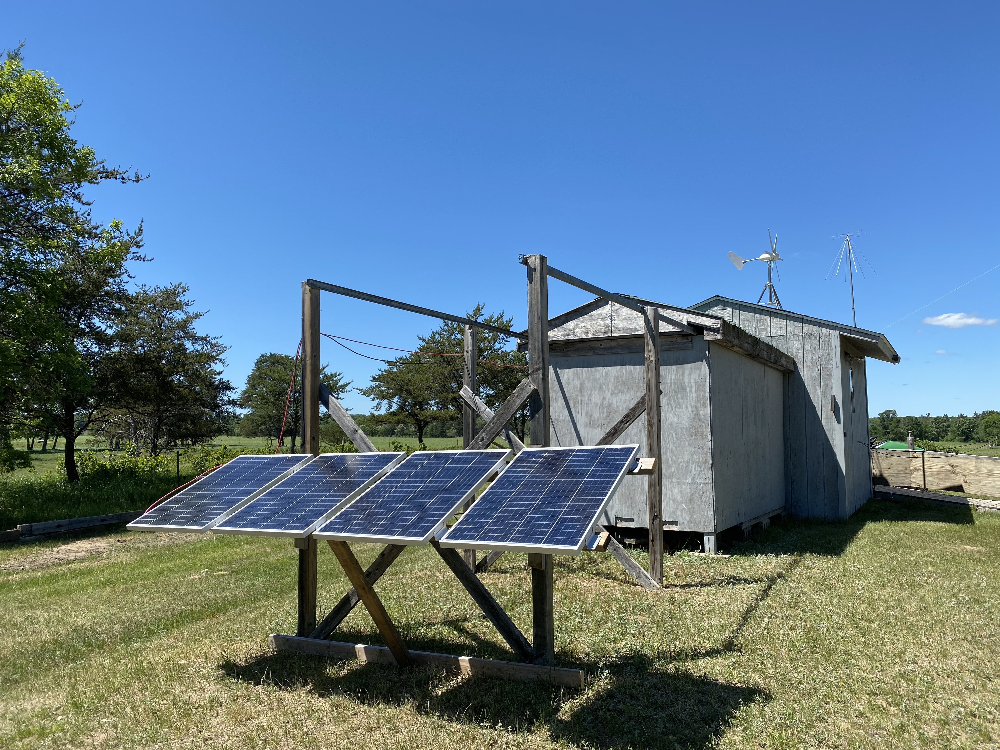

We’re officially running the observatory completely on solar energy now.

- 4 x 100w solar panels with 40 amp MPPT charge controller
- 24 volt lithium-ion battery-wall system (560 18650’s in 7s configuration)
- 3000 watt (6000 peak) inverter

